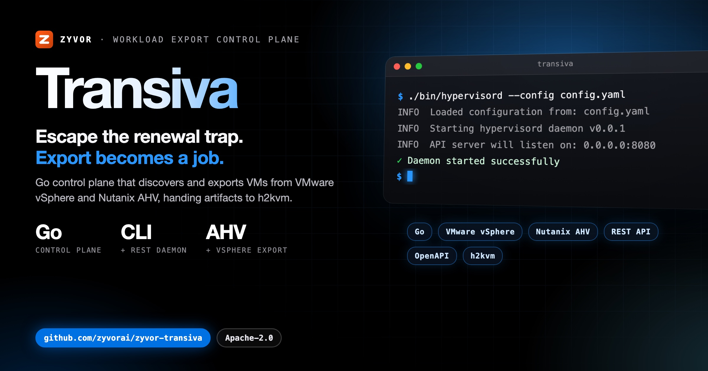
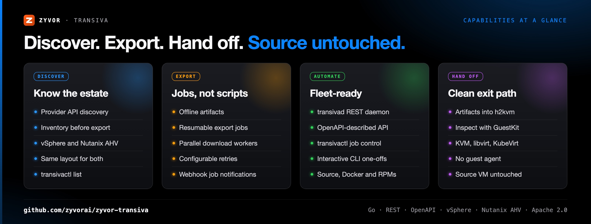
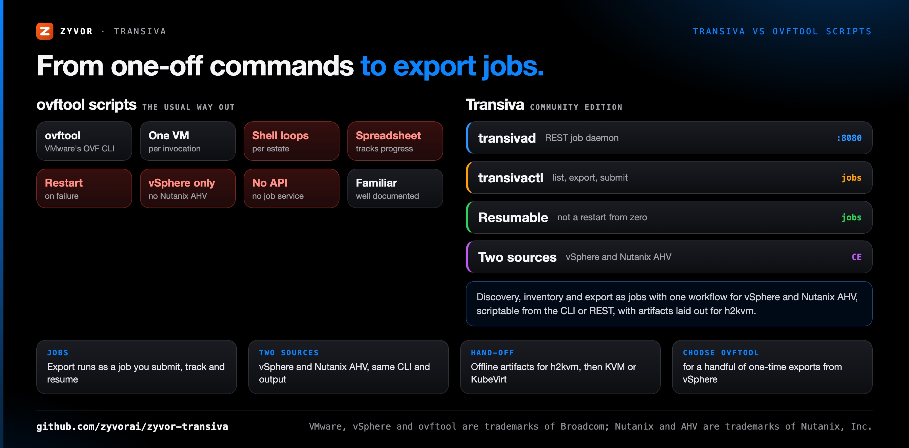
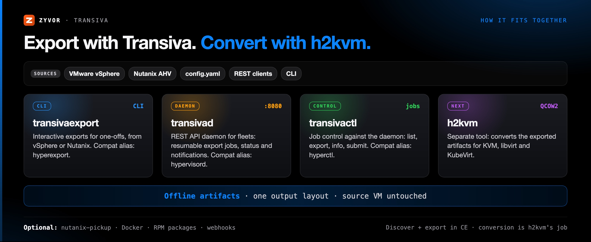

<div align="center">

# Transiva — Community Edition

[](https://github.com/zyvorai/zyvor-transiva/actions/workflows/ci.yml)
[](https://github.com/zyvorai/zyvor-transiva/tags)
[](https://go.dev/)
[](https://www.apache.org/licenses/LICENSE-2.0)

[](https://zyvor.dev/schedule?utm_source=github&utm_medium=transiva&utm_campaign=readme_hero)
[](https://zyvor.dev/poc?utm_source=github&utm_medium=transiva&utm_campaign=readme_hero)
[](#quickstart)



### Escape the renewal trap. Export becomes a job.

**Enterprise workload mobility starts with honest offline export.** Transiva Community Edition is a Go control plane that discovers, inventories, and orchestrates workload exports from VMware vSphere and Nutanix AHV, handing artifacts to [h2kvm](https://github.com/zyvorai/zyvor-h2kvm) for conversion. Fleet jobs run over REST and CLI — **Apache-2.0**, no guest agent, source VM untouched until cutover.

**2 source hypervisors (CE)** · **1 workflow for both** · **0 guest agents** · **Resumable export jobs** · **CLI + REST**

[**Platform docs**](https://zyvor.dev/docs/transiva-platform?utm_source=github&utm_medium=transiva&utm_campaign=readme_hero) · [**Nutanix guide**](docs/nutanix.md) · [**OpenAPI**](openapi.yaml) · [**Community vs Platform**](#community-edition-vs-transiva-platform)

</div>

---

## Why Transiva

| When this happens… | Transiva gives you… |
|---|---|
| Every hypervisor renewal buries your VMs deeper in someone else's proprietary API | Discovery via the provider API and an inventory of workloads before you export anything |
| Getting out means a spreadsheet, a maintenance window and a pile of one-off `ovftool` invocations | Export as a job: interactive CLI for one-offs, `transivad` plus REST for fleets |
| An export fails mid-transfer and starts again from zero | Resumable jobs via `transivad` and REST |
| Part of the estate is on vSphere, part on Nutanix AHV | Two sources, one workflow: same CLI, same jobs, same output layout |
| Nobody will approve an agent in production guests | Offline artifacts, no guest agent, the source VM untouched until cutover |
| The export is only step one of the exit | A clean hand-off: artifacts flow into h2kvm and GuestKit, then KVM, KubeVirt and Zeus OS |



---

## Transiva vs ovftool scripts



| | **Transiva CE** | **ovftool scripts** (the usual way out) |
|---|---|---|
| Unit of work | An export job you submit, track and resume | One `ovftool` invocation per VM |
| Fleet control | `transivad` REST daemon and `transivactl` (`list`, `export`, `info`, `submit`) | Shell loops and a spreadsheet |
| Failure mid-transfer | Resumable job | Run it again |
| Sources | VMware vSphere and Nutanix AHV, one workflow | VMware products |
| Discovery | Provider API discovery and inventory before export | Not part of the tool |
| API | REST, described in [openapi.yaml](openapi.yaml) | Command line only |
| **Choose ovftool when** | | You have a handful of one-time exports from vSphere and a script is enough |

---

## How it fits together



<div align="center">

<picture>
  <source media="(prefers-color-scheme: dark)" srcset="docs/social/migration-1200x630-dark.png">
  
</picture>

**Export with Transiva → convert with [h2kvm](https://github.com/zyvorai/zyvor-h2kvm) → assure with [GuestKit](https://github.com/zyvorai/zyvor-guestkit) → operate on [Zeus OS](https://zyvor.dev/zeus-os?utm_source=github&utm_medium=transiva&utm_campaign=readme_suite) or the open-source [Zorvia](https://github.com/zyvorai/zyvor-zorvia/blob/main/docs/leave-openshift.md).** Each is a separate tool; Zorvia's own importer is Experimental.

</div>

### Where this fits: the Zyvor suite

**transiva** (discover · export) → **[h2kvm](https://github.com/zyvorai/zyvor-h2kvm)** (convert to QCOW2) → **[GuestKit](https://github.com/zyvorai/zyvor-guestkit)** (inspect · repair) → KVM · libvirt · KubeVirt → **[Zeus OS](https://zyvor.dev/zeus-os?utm_source=github&utm_medium=transiva&utm_campaign=readme_suite)** (day-2).

Methodology: **Discover → Assess → Convert → Deploy → Operate → Optimize.** This repo covers discover + export in CE. [Full hypervisor-exit route →](https://zyvor.dev/hypervisor-exit?utm_source=github&utm_medium=transiva&utm_campaign=readme_suite) · The diagram and stage table: [docs/suite-fit.md](docs/suite-fit.md).

---

<a id="60-second-quick-start"></a>

## Quickstart

Requires Go 1.27+ to build ([go.mod](go.mod)), and a vSphere or Nutanix AHV endpoint to export from.

```bash
git clone https://github.com/zyvorai/zyvor-transiva.git
cd zyvor-transiva
./scripts/build.sh

cp config.example.yaml config.yaml
# edit config.yaml for your vSphere endpoint
./bin/hyperexport --config config.yaml
```

Nutanix AHV, the daemon and REST API, and the binaries table are in **[docs/quick-start.md](docs/quick-start.md)**; the Nutanix walkthrough is **[docs/nutanix.md](docs/nutanix.md)**. Legacy `hyper*` binaries remain compatibility aliases for at least one major release.

<a id="binaries"></a>

| Binary | Role |
|--------|------|
| `transivaexport` (compat: `hyperexport`) | Interactive CLI exports (vSphere, Nutanix, …) |
| `transivad` (compat: `hypervisord`) | REST API daemon |
| `transivactl` (compat: `hyperctl`) | Job control — `list`, `export`, `info`, `submit` |
| `nutanix-pickup` | Standalone Nutanix discovery/pickup |

The example config's daemon address is `0.0.0.0:8080` (`daemon_addr` in [config.example.yaml](config.example.yaml)).

---

## The renewal trap — escaped with an API

Every hypervisor renewal buries your VMs deeper in someone else’s proprietary API. Getting out usually means a spreadsheet, a maintenance window, and a pile of one-off `ovftool` invocations. **Transiva turns that into a job.**

<div align="center">

| **2** source hypervisors (CE) | **1** workflow for both | **0** guest agents |
|:---:|:---:|:---:|
| Apache-2.0 | CLI + REST | Offline export — source VM untouched |

</div>

<table>
<tr>
<td valign="top" width="33%">
<b>Discover and inventory</b><br>
Discover via the provider API and inventory workloads before you export anything.<br>
<a href="docs/renewal-trap.md">The renewal trap</a>
</td>
<td valign="top" width="33%">
<b>Resumable exports</b><br>
Export fails mid-transfer? Resumable jobs via <code>transivad</code> and REST, not a restart from zero.<br>
<a href="docs/quick-start.md">Quick start</a>
</td>
<td valign="top" width="33%">
<b>Two sources, one workflow</b><br>
vSphere and Nutanix AHV behave identically: same CLI, same jobs, same output layout.<br>
<a href="docs/nutanix.md">Nutanix guide</a>
</td>
</tr>
<tr>
<td valign="top" width="33%">
<b>Offline, no guest agent</b><br>
Offline artifacts; the source VM is untouched until cutover.<br>
<a href="docs/renewal-trap.md">Why teams start here</a>
</td>
<td valign="top" width="33%">
<b>Scriptable end to end</b><br>
Interactive CLI for one-offs; daemon plus REST for fleets. Source, Docker and RPMs.<br>
<a href="openapi.yaml">OpenAPI</a>
</td>
<td valign="top" width="33%">
<b>Clean handoff</b><br>
Artifacts flow into h2kvm and GuestKit, then KVM, KubeVirt and Zeus OS.<br>
<a href="docs/suite-fit.md">Where it fits</a>
</td>
</tr>
</table>

<a id="why-teams-start-here"></a>

---

## Community Edition vs Transiva Platform

**CE proves export. Platform runs the hypervisor-exit program.**

CE is free forever for labs — two sources, CLI, GitHub Issues. If you are moving an estate: no CBT, no waves, no SSO, no named owner on cutover night. **Buy Platform.**

| | **Community Edition** *(this repo)* | **[Transiva Platform](https://zyvor.dev/transiva?utm_source=github&utm_medium=transiva&utm_campaign=readme_edition)** |
|---|---|---|
| **Who it is for** | Labs · PoC · single-host | Platform / SRE leads · **50–10,000+ VMs** |
| **Sources** | vSphere, Nutanix AHV | **10–11 providers** — Hyper-V, AWS, Azure, GCP, OCI, OpenStack, Proxmox, KubeVirt, … |
| **Incremental** | Full exports only | **CBT** + smart fallback — windows that fit change freeze |
| **Security** | Config-file credentials | Vault · **SSO/OIDC/SAML** · RBAC · audit · air-gap packs |
| **Support** | [GitHub Issues](https://github.com/zyvorai/zyvor-transiva/issues) | **SLA** · workshops · hypervisor-exit PS |

<a id="why-teams-upgrade"></a>**[Full feature matrix →](docs/ce-vs-enterprise.md)**

**Bring us your worst estate.** [30-day PoC](https://zyvor.dev/poc?utm_source=github&utm_medium=transiva&utm_campaign=readme_footer) · [Platform demo](https://zyvor.dev/contact?intent=demo&utm_source=github&utm_medium=transiva&utm_campaign=readme_footer) · [Pricing](https://zyvor.dev/pricing?utm_source=github&utm_medium=transiva&utm_campaign=readme_footer)

---

## Development

```bash
make test
make lint
```

PRs welcome. Security reports → [SECURITY.md](SECURITY.md).

## Support the project

Transiva Community Edition is free and open source, maintained by **Susant Sahani** at [Zyvor AI Labs](https://zyvor.dev?utm_source=github&utm_medium=transiva&utm_campaign=readme_footer).

| | |
|---|---|
| **Production / Platform** | [Book a demo](https://zyvor.dev/schedule?utm_source=github&utm_medium=transiva&utm_campaign=readme_footer) · [30-day PoC](https://zyvor.dev/poc?utm_source=github&utm_medium=transiva&utm_campaign=readme_footer) · [sales@zyvor.dev](mailto:sales@zyvor.dev) |
| **Community** | [GitHub Issues](https://github.com/zyvorai/zyvor-transiva/issues) |
| **General** | [info@zyvor.dev](mailto:info@zyvor.dev) |

<a id="related-open-source-repos"></a>Related repositories (h2kvm, guestkit, chimera, netevd), social assets and more: [docs/support-and-related.md](docs/support-and-related.md).

## Documentation

| Topic | Doc |
|---|---|
| Every page, in one list | [docs/documentation-map.md](docs/documentation-map.md) |
| Quick start, binaries, Nutanix | [docs/quick-start.md](docs/quick-start.md) · [docs/nutanix.md](docs/nutanix.md) |
| The renewal trap and why teams start here | [docs/renewal-trap.md](docs/renewal-trap.md) |
| Where Transiva fits in the Zyvor suite | [docs/suite-fit.md](docs/suite-fit.md) |
| Community Edition vs Platform | [docs/ce-vs-enterprise.md](docs/ce-vs-enterprise.md) (canonical matrix) |
| REST API | [openapi.yaml](openapi.yaml) |

---

## Maturity

> **Maturity (honest):** CE covers **two sources** and **full exports** (no CBT, no multi-provider dashboard). Ten-plus providers, waves, SSO, and cutover-night support are **Transiva Platform** — [feature matrix](docs/ce-vs-enterprise.md).

Legacy `hyper*` binaries remain compatibility aliases for at least one major release.

---

## Part of the Zyvor stack

| Product | Role next to Transiva |
|---|---|
| **Transiva** | Discover and export VMs from vSphere and Nutanix AHV, as jobs |
| **[Scout](https://github.com/zyvorai/scout)** | Pairs with Transiva before export: read-only readiness scoring and migration-wave planning |
| **[h2kvm](https://github.com/zyvorai/zyvor-h2kvm)** | Converts Transiva's exported artifacts to QCOW2 and deploys them |
| **[GuestKit](https://github.com/zyvorai/zyvor-guestkit)** | Inspects and repairs the converted guests |
| **[Zorvia](https://github.com/zyvorai/zyvor-zorvia)** | Open-source KubeVirt platform to operate the workloads on |

→ [zyvor.dev](https://zyvor.dev)

---

## License

Transiva Community Edition is **free and open source** under the [Apache License, Version 2.0](LICENSE) (see [NOTICE](NOTICE)). You may use, modify, and run it for personal, lab, and commercial production use at no charge, subject to Apache-2.0 (preserve notices / NOTICE where required). That does not change.

**Zyvor Enterprise** adds what production teams ask for: supported releases, deployment and upgrade guidance, priority incident triage, a named technical contact and 24x7 critical intake. Plans and terms: [docs/SUBSCRIPTION-MODEL.md](docs/SUBSCRIPTION-MODEL.md) · [Pricing](https://zyvor.dev/pricing?utm_source=github&utm_medium=transiva&utm_campaign=readme_license) · [sales@zyvor.dev](mailto:sales@zyvor.dev).

Security reports → [SECURITY.md](SECURITY.md).

---

<div align="center">

### Bring us your worst estate

[](https://zyvor.dev/schedule?utm_source=github&utm_medium=transiva&utm_campaign=readme_footer)
[](https://zyvor.dev/poc?utm_source=github&utm_medium=transiva&utm_campaign=readme_footer)
[](https://zyvor.dev/pricing?utm_source=github&utm_medium=transiva&utm_campaign=readme_footer)
[](mailto:sales@zyvor.dev?subject=Transiva)
[](https://github.com/zyvorai/zyvor-transiva)

</div>
